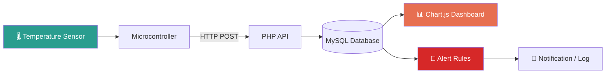
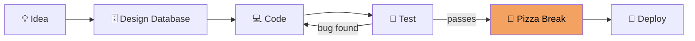

<p align="center">
  
</p>

<p align="center">
  
</p>

<!-- Pizza eating animation: the pizza shrinks slice by slice, then respawns -->
<p align="center">
  
</p>

<p align="center">
  
  
  
  
</p>

---

## 🚀 About Me

```js
const jrald = {
  name: "Jrald Baco",
  role: "Information Technology Student",
  focus: ["Web Development", "System Development", "IoT Dashboards"],
  strengths: ["Database-driven systems", "Real-time monitoring", "Dashboards"],
  stack: ["PHP", "MySQL", "JavaScript", "Chart.js", "Bootstrap"],
  fuel: "🍕 Pizza",
  currentlyBuilding: ["IoT Room Monitoring", "StockSmart", "Student Records System"],

  isHungry() { return true; },
  code() { while (this.isHungry()) this.eat("pizza"); },
};
```

<details>
<summary><b>🍕 More about me (click to expand)</b></summary>

<br>

- 🎓 Studying Information Technology
- 🌡️ Love connecting hardware data to live dashboards
- 🗄️ Enjoy designing clean, normalized databases
- 🤝 Open to collaboration on web and IoT projects
- 🍕 Favorite topping: *whatever's in the box*

</details>

---

## 🛠️ Tech Stack

<p align="center">
  
  <br><br>
  
  
</p>

### 🍕 Skill Slices

| Skill | Level |
|---|---|
| PHP |  |
| MySQL / SQL |  |
| HTML & CSS |  |
| JavaScript |  |
| Bootstrap |  |
| Chart.js |  |

---

## 🔥 Featured Projects

<p align="center">
  <a href="https://github.com/jraldGITHUB/An-IoT-Based-Room-Temperature">
    
  </a>
</p>

<!--
MORE PROJECT CARDS: replace REPO_NAME_... with your real repo names, move the blocks above the closing comment tag out, and they will show.

  <a href="https://github.com/jraldGITHUB/REPO_NAME_STOCKSMART">
    
  </a>
  <a href="https://github.com/jraldGITHUB/REPO_NAME_STUDENTS">
    
  </a>
-->

| Project | What it does | Stack |
|---|---|---|
| 🌡️ **[IoT Room Monitoring System](https://github.com/jraldGITHUB/An-IoT-Based-Room-Temperature)** | Real-time temperature dashboard with alerts and logs | PHP · MySQL · Chart.js · JavaScript |
| 📦 **StockSmart Inventory System** | Restaurant stock tracking with a management dashboard | PHP · MySQL · Bootstrap |
| 🎓 **Student Records Management System** | Enrollment and student database management | PHP · MySQL · HTML/CSS |

### 🌡️ How my IoT monitoring system flows



### 🔄 My development workflow



---

## 📊 GitHub Stats

<p align="center">
  
  
</p>

<p align="center">
  
</p>

<p align="center">
  
</p>

<p align="center">
  
</p>

---

## 🎯 Goals

- [x] Build PHP and MySQL CRUD systems
- [x] Create dashboards with Chart.js
- [ ] Connect real sensors to live dashboards
- [ ] Build REST APIs with cleaner backend structure
- [ ] Deploy projects online
- [ ] Eat pizza in every country 🌍🍕

---

## 😄 Dev Joke of the Moment

<p align="center">
  
</p>

---

## 📫 Let's Connect

<p align="center">
  <a href="mailto:jraldybaco@gmail.com">
    
  </a>
  <a href="https://github.com/jraldGITHUB">
    
  </a>
</p>

<p align="center">
  
</p>
